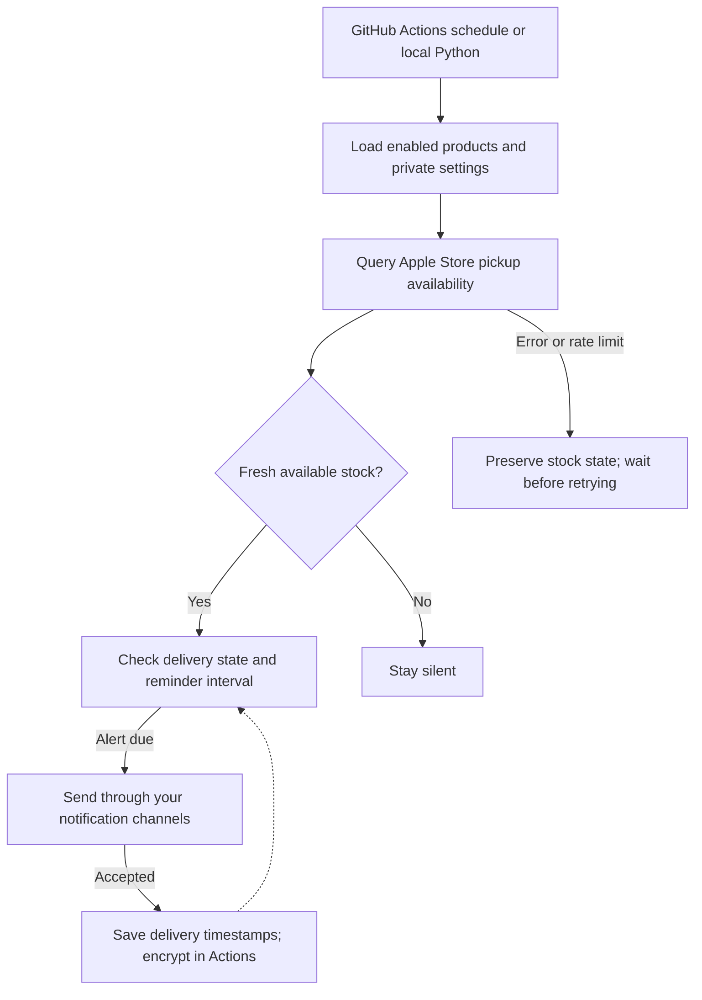

<div align="center">

<h1>Apple Stock Radar</h1>

<p>An open-source Apple Store stock monitor for iPhone, Mac, iPad, Apple Watch, and AirPods, with US pickup availability checks and restock notifications through GitHub Actions or Python.</p>

<p>
  <a href="LICENSE"></a>
  <a href="https://github.com/Ar2mis/apple-stock-radar/actions/workflows/ci.yml"></a>
  <a href="pyproject.toml"></a>
  <a href="#local-setup"></a>
  <a href="https://github.com/Ar2mis/apple-stock-radar/commits/main/"></a>
</p>

<p>
  <a href="#live-demo--quick-start"><strong>Quick Start</strong></a> ·
  <a href="#screenshot--demo-preview">Demo Preview</a> ·
  <a href="#notification-configuration">Notifications</a> ·
  <a href="#how-it-works">How It Works</a> ·
  <a href="https://github.com/Ar2mis/apple-stock-radar/fork">Fork this project</a>
</p>

</div>

## Live Demo / Quick Start

**Get stock alerts without writing code or keeping your computer on.** Use your own GitHub fork and notification account. This project runs as a command-line tool and a scheduled GitHub Actions workflow; [see the demo preview](#screenshot--demo-preview) below.

### Three steps with GitHub Actions

1. **Fork and choose products.** [Fork this repository](https://github.com/Ar2mis/apple-stock-radar/fork). In **your fork**, open `products.json`, click the pencil to edit, change the variants you want from `"enabled": false` to `"enabled": true`, and commit. Leave their category and model switches enabled too. All shipped variants start disabled. Open **Actions** and enable workflows if GitHub prompts you.
2. **Add your private settings.** Open **Settings → Secrets and variables → Actions**. For Bark, create repository **Secrets** named `ZIP_CODE` (your US ZIP), `BARK_KEY` (your Bark device key), and `STATE_ENCRYPTION_KEY` (generate below). Under **Variables**, add `NOTIFY_CHANNELS=bark` and `MONITOR_ENABLED=true`. For another channel, use the [credential table](#notification-configuration).
3. **Test, then monitor.** In your fork, open **Actions → Stock Monitor → Run workflow**, check `test_notification`, and run it to send one clearly labeled test push. Run it again with that box unchecked for a stock check. Enable **Stock Monitor** if its schedule is disabled on your fork. Scheduled checks then run every five minutes. To stop, set `MONITOR_ENABLED=false` or disable the workflow.

<details>
<summary><strong>Generate your private encryption key — copy one command</strong></summary>

Run this on your own computer, then paste its output into the `STATE_ENCRYPTION_KEY` repository secret. Keep the key private; do not put it in a workflow file, issue, or public key generator.

macOS / Linux, with OpenSSL:

```sh
openssl rand -base64 32 | tr '+/' '-_'
```

Windows PowerShell:

```powershell
$bytes = New-Object byte[] 32; [System.Security.Cryptography.RandomNumberGenerator]::Create().GetBytes($bytes); [Convert]::ToBase64String($bytes).Replace('+','-').Replace('/','_')
```

After a [local installation](#local-setup), Python also works:

```sh
python -c "from cryptography.fernet import Fernet; print(Fernet.generate_key().decode())"
```

</details>

**Timing:** GitHub Actions checks every **five minutes** and can run late. Local mode checks every **60 seconds** by default and repeats successful stock alerts no sooner than **three minutes** while availability continues. Out-of-stock checks send no pushes. [More on scheduling and privacy](#cloud-scheduling-and-privacy).

## Screenshot / Demo Preview

The interface is your terminal or the **Stock Monitor** workflow's run log, plus notifications in your chosen app. The preview below uses **synthetic data**, not live inventory or a real store.

**Try the offline demo** after [local setup](#local-setup); it needs no ZIP code or notification credentials and sends nothing:

```console
$ python -m apple_stock_radar --offline --dry-run
{"checked": 1, "available": 1, "errors": 0, "cooldown": false}
```

**Illustrative notification content** for that synthetic product, if a real availability check triggered a push. The offline demo does not send this message:

```text
┌──────────────────────────────────────────────────────┐
│  Apple pickup stock available                        │
│                                                      │
│  Synthetic iPhone                                    │
│  Example Store — available for pickup                 │
│  https://www.apple.com/shop                           │
└──────────────────────────────────────────────────────┘
```

Notification appearance depends on Bark, Telegram, Pushover, Discord, or ntfy. Preview the configured adapters without sending a push with `python -m apple_stock_radar --notification-dry-run`.

## Features

| Feature | What you get |
| --- | --- |
| **Five Apple product families** | iPhone, Mac, iPad, Apple Watch, and AirPods in a readable [product catalog](products.json), organized by category, model, and storage/color variant. |
| **Targeted pickup alerts** | Select products, a US ZIP code, search radius, and optional store-name filters. |
| **Five notification channels** | Bark, Telegram, Pushover, Discord, and ntfy; send to one or several channels. |
| **Quiet monitoring** | Notify on fresh available results and repeat at your chosen interval. No out-of-stock pushes; failed queries remain unknown. |
| **Local or cloud operation** | Python on macOS, Windows, or Linux, or scheduled GitHub Actions without an always-on computer. |
| **Catalog discovery** | Import official Apple Store URLs and review weekly PRs for newly discovered SKUs. New entries stay disabled until selected. |
| **Private configuration** | Environment variables, ignored `.env` files, GitHub Secrets, encrypted cloud state, and errors that omit secret-bearing URLs. |
| **Reviewable behavior** | Offline demos, mocked notification tests, CI, pinned Actions, and an [audit guide](AUDIT.md). |

## How It Works



Each alert is tracked by product, store, and notification channel. A successful push starts that channel's reminder timer; a failed submission is retried only after another fresh available result. An affirmative out-of-stock result resets the stock episode. Missing or failed queries never masquerade as sold out.

Separately, the **weekly catalog updater** reads Apple's public category/model pages, extracts named official part numbers, and opens a PR containing new disabled variants. You review and merge it; existing selections are preserved. It does not discover unpublished SKUs.

## Local Setup

Requires **Python 3.11+** and a checkout of this repository. No Apple account is needed.

```sh
git clone https://github.com/Ar2mis/apple-stock-radar.git
cd apple-stock-radar
python3 -m venv .venv
```

Activate the environment and copy the configuration:

```sh
# macOS / Linux
source .venv/bin/activate
cp .env.example .env
```

```powershell
# Windows PowerShell: use `py -3 -m venv .venv` if python3 is unavailable
.venv\Scripts\Activate.ps1
Copy-Item .env.example .env
```

```sh
python -m pip install -e .
```

Edit `.env` with your ZIP, selected channels, and credentials. Enable your desired variants in `products.json`, then run:

```sh
python -m apple_stock_radar --validate-catalog
python -m apple_stock_radar --dry-run       # live lookup; no pushes or state writes
python -m apple_stock_radar                # Ctrl+C stops monitoring
```

`STARTUP_NOTIFICATION=true` sends one labeled test on local continuous startup. To test a channel explicitly, run `python -m apple_stock_radar --test-notification`. Service acceptance confirms submission; check your device to confirm delivery.

## Notification Configuration

Set `NOTIFY_CHANNELS` to a comma-separated list, such as `bark,telegram`. Only selected channels need credentials. These values belong in your local `.env` or your fork's **GitHub Secrets**.

| Channel | `NOTIFY_CHANNELS` value | Required credentials | Optional settings |
| --- | --- | --- | --- |
| Bark | `bark` | `BARK_KEY` | `BARK_SERVER` |
| Telegram | `telegram` | `TELEGRAM_BOT_TOKEN`, `TELEGRAM_CHAT_ID` | — |
| Pushover | `pushover` | `PUSHOVER_API_TOKEN`, `PUSHOVER_USER_KEY` | — |
| Discord | `discord` | `DISCORD_WEBHOOK_URL` | — |
| ntfy | `ntfy` | `NTFY_TOPIC` | `NTFY_TOKEN`, `NTFY_SERVER` |

**What is a Bark key?** It is the device key: the first path segment after `https://api.day.app/` in the Bark app's test URL. Enter only that key in `BARK_KEY`. Keep the full test URL private too. Custom Bark/ntfy servers must use HTTPS. Discord messages disable mentions. Notification-provider account requirements and pricing are separate from this project.

All settings and defaults are listed in [.env.example](.env.example). In Actions, use **Secrets** for credentials, `ZIP_CODE`, `STATE_ENCRYPTION_KEY`, and optional `STORE_NAMES`. Use **Variables** for `MONITOR_ENABLED`, `NOTIFY_CHANNELS`, and the optional non-secret settings below.

| Setting | Default | Behavior |
| --- | --- | --- |
| `SEARCH_RADIUS_MILES` | `50` | Filter returned stores by distance; `0` accepts all returned stores. Missing distance fails closed when a radius is set. |
| `CHECK_INTERVAL_SECONDS` | `60` | Local polling interval; the cloud cadence comes from the workflow's cron schedule. |
| `REPEAT_NOTIFICATION_SECONDS` | `180` | Repeat on the next fresh available result after this interval; `0` means once per stock episode. |
| `STORE_NAMES` | Empty | Optional comma-separated store-name substrings. |
| `BARK_SERVER` / `NTFY_SERVER` | Public provider endpoints | Optional HTTPS endpoints for your chosen service. |

## Cloud Scheduling and Privacy

Cloud monitoring requires both enabled products and `MONITOR_ENABLED=true`. On forks, GitHub disables scheduled workflows by default; [enable the workflow in your fork](https://docs.github.com/en/actions/how-tos/manage-workflow-runs/disable-and-enable-workflows).

The workflow runs every **five minutes**, offset from the top of the hour. GitHub's shortest schedule is five minutes; runs can be delayed or dropped, and schedules on inactive public repositories can be disabled after 60 days. Three-minute reminders apply to local mode; Actions reminders arrive on the next scheduled successful check. See [GitHub's scheduling documentation](https://docs.github.com/en/actions/reference/workflows-and-actions/events-that-trigger-workflows#schedule).

Only authenticated encrypted state enters the Actions cache. The key stays in `STATE_ENCRYPTION_KEY`; no `.env`, raw stock responses, or location records are uploaded as artifacts. A keyed cache scope separates location/filter settings. Cache eviction or an interrupted run can cause a repeated alert. Keep the workflow's concurrency setting and use one local runner per state file.

Apple may block GitHub-hosted IPs. The monitor respects 403/541 cooldowns and 429 `Retry-After`, including across cloud runs. Apple's pickup endpoint is an undocumented website interface and can change. This is a best-effort US pickup monitor, not a real-time feed or a delivery-stock tracker.

## Add Apple Products

Paste a specific Apple Store product URL into the helper:

```sh
python add_product.py 'https://www.apple.com/shop/product/YOUR_OFFICIAL_PART/A'
# For a model page, first list its candidates:
python add_product.py 'https://www.apple.com/shop/buy-iphone/iphone-18-pro'
# Import all candidates disabled, or choose one with --part OFFICIAL_PART/A:
python add_product.py 'https://www.apple.com/shop/buy-iphone/iphone-18-pro' --all
```

The importer reads named product records, JSON-LD offers, and Mac/Watch selector data. It verifies parts against Apple page metadata. Ambiguous pages require `--part` or `--all`. Add `--enable` only to enable new entries immediately. Existing toggles are preserved.

The catalog is a discovered snapshot. Some storage/color fields are `null` where Apple provides no unambiguous mapping. Mac custom configurations and Watch case/band combinations may require a more specific configured URL; confirm your configuration before enabling it. A published SKU does not imply availability.

Upcoming products can use `status: "upcoming"`, `part_number: null`, and `enabled: false`. Add only publicly announced models with an official source. Unknown future part numbers are never invented; discovery adds official variants when Apple publishes purchase metadata.

## Weekly Catalog Updates

[update-catalog.yml](.github/workflows/update-catalog.yml) reads the public category pages in [catalog_sources.json](catalog_sources.json), follows newly linked model pages, and opens or updates a PR on `automation/apple-catalog`. All additions are disabled, existing selections stay intact, and nothing is auto-merged. Discovery is bounded to 40 pages and stops on access denial or rate limiting; failed page requests do not write a partial update.

In your fork's **Settings → Actions → General → Workflow permissions**, enable **Allow GitHub Actions to create and approve pull requests**. Enable **Update Catalog** in Actions if its schedule is disabled. No personal access token is required. Only this job grants `contents: write` and `pull-requests: write`; it validates and tests before opening a PR. PRs created with `GITHUB_TOKEN` may not trigger separate CI automatically, so the updater runs those checks itself.

```sh
python update_catalog.py
python -m apple_stock_radar --validate-catalog
```

Discovery is best-effort and cannot guarantee every variant. Review model names, part numbers, and configuration details before merging.

## Development and Security

```sh
python -m unittest discover -s tests -v
python -m apple_stock_radar --offline --dry-run
python -m apple_stock_radar --notification-dry-run
python scripts/audit_public.py
```

The modules separate configuration, catalog parsing, HTTP transport, stock checks, notifications, state, and CLI behavior. Tests use synthetic data and mocked pushes. CI checks Python 3.11 and 3.13, catalog validation, offline execution, notification dry runs, and tracked files for likely secrets.

Contributions are welcome: [CONTRIBUTING.md](CONTRIBUTING.md) explains development, [SECURITY.md](SECURITY.md) covers reporting, and [AUDIT.md](AUDIT.md) records publication safeguards. Never commit `.env`, personal stock snapshots, or unencrypted state. Errors omit request URLs and provider response bodies that could contain tokens.

**MIT licensed. Unofficial and not affiliated with Apple.** The project checks availability and sends notifications; it does not log in, reserve, or purchase products.
